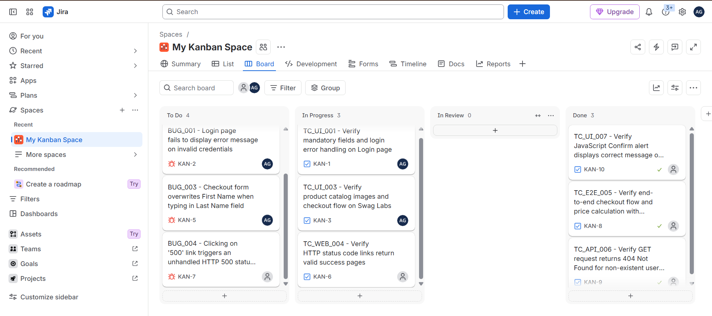
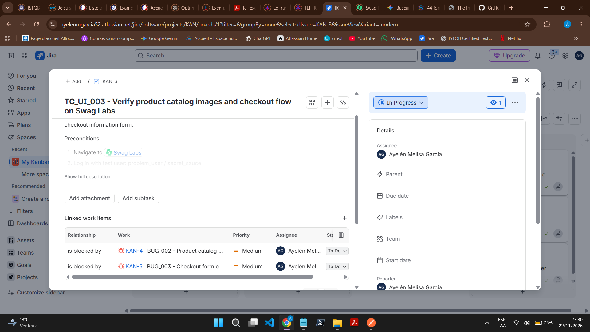

# QA Manual & API Testing Portfolio (Jira Kanban)

Welcome to my Quality Assurance portfolio! This repository showcases my hands-on practice designing test cases, executing functional, E2E, and API tests, reporting defects, and managing traceability within **Jira Software**.

---

## 🛠️ Tools & Technologies Used
* **Test & Defect Management:** Jira Software (Kanban Workflow, Linked Issues, Execution Logs)
* **API Testing:** Postman (HTTP Methods, Status Code Validation)
* **Web Applications Tested:**
  * [Swag Labs (SauceDemo)](https://www.saucedemo.com/) — E-commerce UI & Checkout flow
  * [The Internet (Herokuapp)](https://the-internet.herokuapp.com/) — HTTP Status Codes & JS Alerts
  * [JSONPlaceholder](https://jsonplaceholder.typicode.com/) — REST API Endpoints
* **Environment:** Windows 11, Brave / Chrome Browser

---

## 📋 Test Coverage Summary

| Ticket ID | Type | Title | Test Area | Status |
| :--- | :--- | :--- | :--- | :--- |
| **KAN-1** | Test Case | `TC_UI_001` - Verify mandatory fields and login error handling | UI / Login | Blocked (`KAN-2`) |
| **KAN-2** | Bug | `BUG_001` - Login page fails to display error message on invalid credentials | UI / Login | Open |
| **KAN-3** | Test Case | `TC_UI_003` - Verify product catalog images and checkout flow | UI / E-commerce | Blocked (`KAN-4`, `KAN-5`) |
| **KAN-4** | Bug | `BUG_002` - Product catalog displays incorrect placeholder dog image | UI / Catalog | Open |
| **KAN-5** | Bug | `BUG_003` - Checkout form overwrites First Name when typing Last Name | UI / Checkout | Open |
| **KAN-6** | Test Case | `TC_WEB_004` - Verify HTTP status code links return valid pages | Web / Navigation | Blocked (`KAN-7`) |
| **KAN-7** | Bug | `BUG_004` - Clicking on '500' link triggers unhandled HTTP 500 error | Web / Server Error | Open |
| **KAN-8** | Test Case | `TC_E2E_005` - Verify end-to-end checkout flow and price calculation | E2E / Happy Path | **PASSED** |
| **KAN-9** | Test Case | `TC_API_006` - Verify GET request returns 404 Not Found for invalid ID | API / REST | **PASSED** |
| **KAN-10** | Test Case | `TC_UI_007` - Verify JavaScript Confirm alert message on Cancel | UI / Alerts | **PASSED** |

---

## 📸 Jira Evidence & Traceability

### 1. Kanban Board Workflow
Overview of the testing lifecycle organized across **To Do** (open defects), **In Progress** (blocked test cases awaiting bug fixes), and **Done** (passed E2E, UI, and API validations).

---

### 2. Test Case Execution & Defect Traceability
Example of a structured Test Case (`TC_UI_003`) linked via `is blocked by` relationships to the specific defects discovered during execution (`KAN-4` and `KAN-5`).

---

### 3. Detailed Bug Report with Visual Evidence
Standardized bug report (`BUG_002`) including clear reproduction steps, expected vs. actual results, environment details, and attached screenshot evidence.

